<!--
  Crawl Cove (CrawlCove): a desktop SEO crawler with a free plan, and open-source tools for technical SEO.
  Website: https://crawlcove.com
  Download: https://crawlcove.com/download
-->

<details>
<summary><a name="hero"></a></summary>
<br />

**Dive brief**

- **The crawler**: a desktop app that crawls your site and lists every issue, the pages it is on and the fix. The free plan covers 1 project and 1,000 URLs a crawl. No account, no card.
- **The kit**: 16 open-source tools for the jobs around a crawl. Redirects, sitemaps, robots.txt, hreflang, schema, CI checks.
- **The rule**: the crawler runs on your machine and your crawl data stays there.

<a href="https://crawlcove.com/download"></a> <a href="#h-tools"></a>
</details>

<p align="center">
  <b>Crawl Cove</b> is a desktop <b>SEO crawler</b> with a free plan.<br />
  These are the open-source tools we wrote around it. Take what you need.
</p>

## <a name="h-dive"></a> The dive

Every site looks calm from the surface. Then you send something down with a lamp.

<details>
<summary><a name="dive"></a></summary>
<br />


**What the lamp picks out.** A crawl follows every internal link the way a search engine does, and logs what it meets on the way down:

- Broken links and the pages that link to them
- Redirect chains and loops
- Pages shut out of search by noindex or robots.txt
- Missing or duplicate titles, meta descriptions and H1s
- Canonical, hreflang and structured data mistakes
- Pages that sit too many clicks from the homepage

The desktop app does all of it in one crawl and turns the log into a fix list. The tools below each do one of those jobs from a terminal or a pipeline.

<a href="https://crawlcove.com/download"></a>
</details>

## <a name="h-tools"></a> Pick your kit

Fourteen small tools and one large one. Each card opens its repo.

<p><a href="https://crawlcove.com/download"></a><a href="https://github.com/CrawlCove/seo-crawler-cli"></a><a href="https://github.com/CrawlCove/seo-audit-action"></a><a href="https://github.com/CrawlCove/seo-mcp-server"></a><a href="https://github.com/CrawlCove/redirect-chain-checker"></a><a href="https://github.com/CrawlCove/xml-sitemap-validator"></a><a href="https://github.com/CrawlCove/robots-txt-tester"></a><a href="https://github.com/CrawlCove/hreflang-checker"></a><a href="https://github.com/CrawlCove/schema-markup-validator"></a><a href="https://github.com/CrawlCove/seo-crawl-export-spec"></a><a href="https://github.com/CrawlCove/seo-crawl-export-js"></a><a href="https://github.com/CrawlCove/screaming-frog-export-converter"></a><a href="https://github.com/CrawlCove/seo-audit-google-sheets"></a><a href="https://github.com/CrawlCove/wordpress-seo-connector"></a><a href="https://github.com/CrawlCove/seo-chrome-extension"></a><a href="https://github.com/CrawlCove/claude-seo-plugin"></a><a href="https://github.com/CrawlCove/seo-test-site"></a></p>

- **[seo-crawler-cli](https://github.com/CrawlCove/seo-crawler-cli)**: Crawl a site from a script or CI. Checks status codes, redirect chains, titles, meta descriptions, H1s, canonicals, noindex and broken links, and fails the build on regressions.
- **[seo-audit-action](https://github.com/CrawlCove/seo-audit-action)**: Crawl a staging or preview URL on every pull request. Fails the check on broken links, missing titles, noindex and redirect chains, with the details as a PR comment.
- **[seo-mcp-server](https://github.com/CrawlCove/seo-mcp-server)**: Crawl a site, list SEO issues, inspect pages and find broken links from inside Claude, Cursor and other AI assistants.
- **[redirect-chain-checker](https://github.com/CrawlCove/redirect-chain-checker)**: Follow every hop of a URL's redirects and flag chains, loops, HTTPS downgrades, meta refreshes and redirects to error pages.
- **[xml-sitemap-validator](https://github.com/CrawlCove/xml-sitemap-validator)**: Check a sitemap or sitemap index against the sitemaps.org protocol and search engine limits. Flags bad URLs, lastmod dates and cross-host entries.
- **[robots-txt-tester](https://github.com/CrawlCove/robots-txt-tester)**: Fetch and lint a robots.txt, test which URLs each crawler may fetch and see the deciding line. Fails deploys that block the site.
- **[hreflang-checker](https://github.com/CrawlCove/hreflang-checker)**: Validate the hreflang tags on a page or across a whole XML sitemap, including self-reference, x-default and return tags.
- **[schema-markup-validator](https://github.com/CrawlCove/schema-markup-validator)**: Check every schema.org node on a page against the required and recommended properties for rich results.
- **[seo-crawl-export-spec](https://github.com/CrawlCove/seo-crawl-export-spec)**: An open format for site crawl data: JSON Schema and CSV column reference, with a real sample export and a validator script.
- **[seo-crawl-export-js](https://github.com/CrawlCove/seo-crawl-export-js)**: Load, query and convert site crawl data in JavaScript and TypeScript, with typed pages, issues by type and status filters.
- **[screaming-frog-export-converter](https://github.com/CrawlCove/screaming-frog-export-converter)**: Turn an SEO Spider internal_all.csv into the open JSON crawl export format, with a report of which columns carried over.
- **[seo-audit-google-sheets](https://github.com/CrawlCove/seo-audit-google-sheets)**: An Apps Script add-on that turns a site crawl export into an audit workbook: pages, issues by type, pages by status and title and meta flags.
- **[wordpress-seo-connector](https://github.com/CrawlCove/wordpress-seo-connector)**: Bulk-apply fixes from the Crawl Cove desktop crawler to Yoast SEO, Rank Math, SEOPress or AIOSEO, with a change log and one-click revert.
- **[seo-chrome-extension](https://github.com/CrawlCove/seo-chrome-extension)**: On-page SEO checker with an AI visibility report: which AI crawlers can read the page, snippet blocks, llms.txt and extractability. Nothing leaves the browser.
- **[claude-seo-plugin](https://github.com/CrawlCove/claude-seo-plugin)**: Seven SEO skills for Claude Code backed by a real site crawl: audits, broken links, redirects, titles and fixes, from a chat.
- **[seo-test-site](https://github.com/CrawlCove/seo-test-site)**: A deliberately broken SEO test site with 54 planted problems and the expected findings, for testing any SEO crawler.

Most of them run with one line and nothing to install first:

```sh
npx github:CrawlCove/redirect-chain-checker https://example.com/old-page
```

## <a name="h-app"></a> On the seabed

Divers have a rule about glowing things on the seabed. Ignore it this once.

<details>
<summary><a name="chest"></a></summary>
<br />
<a href="https://crawlcove.com/download"></a>

**The Crawl Cove desktop app.** It crawls a site, scores it, and gives you one row per fix with the pages it touches, most urgent first. The free plan is not a trial and does not expire:

- 1 project
- 1,000 URLs a crawl
- Every check and its fix
- The Google Search Console connection

Paid plans add more projects, uncapped crawls, exports, PDF reports and scheduled crawls. [See the plans](https://crawlcove.com/pricing).

<a href="https://crawlcove.com/download">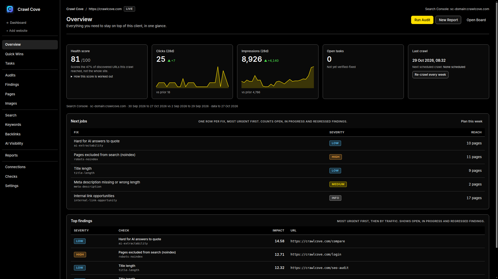</a>

<a href="https://crawlcove.com/download"></a> <a href="https://crawlcove.com/pricing"></a>
</details>

## <a name="h-faq"></a> FAQ

The lantern fish takes questions. It is brief, because it is a fish.

<details>
<summary><a name="faq"></a></summary>
<br />

<details>
<summary><b>What is Crawl Cove?</b></summary>
<br />
A desktop SEO crawler. It crawls your website the way a search engine does, finds broken links, redirect chains, noindex pages, missing titles and more, and tells you which pages to fix and how. Website: <a href="https://crawlcove.com">crawlcove.com</a>.
</details>

<details>
<summary><b>Is the desktop app free?</b></summary>
<br />
There is a free plan with no account, no card and no expiry: 1 project and 1,000 URLs a crawl, with every check, its fix and the Search Console connection. Paid plans add more projects, uncapped crawls, exports, PDF reports and scheduled crawls. <a href="https://crawlcove.com/download">Download it here</a>.
</details>

<details>
<summary><b>Are the tools on this page open source?</b></summary>
<br />
Yes. They are MIT licensed, apart from the WordPress connector, which is GPL v2 like WordPress itself.
</details>

<details>
<summary><b>Do I need the desktop app to use them?</b></summary>
<br />
No. The checkers and the CLI run on their own with <code>npx</code> and Node. The WordPress connector is the exception: it applies fixes found by the desktop app.
</details>

<details>
<summary><b>Can I run SEO checks in CI?</b></summary>
<br />
Yes. <a href="https://github.com/CrawlCove/seo-audit-action">seo-audit-action</a> crawls a preview URL on every pull request and fails the check on broken links, missing titles, noindex and redirect chains. The CLIs exit non-zero on failure, so they fit any pipeline.
</details>

<details>
<summary><b>Where does my crawl data go?</b></summary>
<br />
Nowhere. The desktop crawler and the command-line tools run on your own machine, and the Chrome extension keeps everything in the browser.
</details>

</details>

## <a name="h-works"></a> Works with


<a href="https://crawlcove.com/download"></a>

<p align="center">
<a href="https://crawlcove.com/download"></a> <a href="https://crawlcove.com"></a> <a href="https://crawlcove.com/pricing"></a>
</p>
